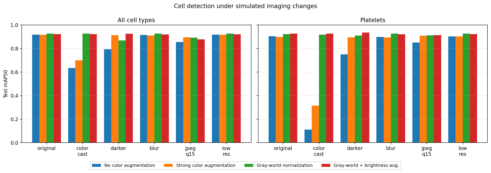

# How Robust Is AI Blood Cell Detection to Changes in How Slides Are Imaged?
### Simulated imaging shifts, color augmentation, and color normalization for YOLO cell detection

Diagnostic AI for cytology is often trained on images from one microscope or camera and then used
with others, including smartphones. This mini-study asks: **how much does a cell detector's accuracy
drop under realistic imaging changes, which cell types are most affected, and which simple training
choices make it robust?**

## Setup
- **Data:** BCCD (Blood Cell Count and Detection), 364 blood-smear images with boxes for red blood
  cells (RBC), white blood cells (WBC), and platelets, using the dataset's own train/val/test split
  (205/87/72 images). A perceptual-hash check found no near-duplicate images between training and test.
- **Model:** YOLOv8-nano, 60 epochs, the same seed and settings for every model.
- **Simulated imaging changes (test set only):** warm color cast (per-channel white-balance shift),
  darker illumination (60% brightness), Gaussian blur (σ = 2 px), heavy JPEG compression (quality 15),
  and lower resolution (40% downscale and back).
- **Four training strategies:** no color augmentation; strong hue/saturation/brightness augmentation;
  gray-world color normalization of all images; and gray-world normalization plus brightness
  augmentation.
- **Metric:** mAP at 0.5 IoU on the test set, overall and per cell type.

## Results
**1. A color cast is the most damaging change, and platelets fail.** With no color augmentation, a
warm white-balance shift dropped overall mAP50 from 0.918 to 0.634, almost entirely because platelet
detection fell from 0.905 to 0.111. Platelet counts from a differently calibrated camera could be
badly wrong.

**2. White cells are robust to every change** (mAP50 ≥ 0.95 throughout), and moderate blur and lower
resolution had no measurable effect on any class.

**3. Color augmentation and color normalization fix different problems.** Hue/saturation/brightness
augmentation fully protected against darker images (0.794 → 0.913) but only partly against the color
cast (platelets 0.111 → 0.314). Gray-world normalization eliminated the color-cast failure (overall
0.926; platelets 0.918) but not the brightness problem (RBC 0.729 on darker images). This is
consistent with a white-balance shift scaling color channels independently, which normalization
undoes but hue rotation does not imitate, while normalization leaves overall brightness unchanged.

**4. Combining normalization with brightness augmentation gave the best worst case.** That model
scored 0.919–0.925 under every change except compression, with a worst case of 0.877, compared with
0.634 for the original model, at no cost on clean images (0.923 vs. 0.918).

**5. Heavy compression remains unsolved,** mainly for red cells (best 0.805 with color augmentation),
likely because compression artifacts blur the boundaries between overlapping cells.

**Red cells are the hardest class even on clean images** (0.86–0.88), despite being the most common.
Overlapping cells make individual boxes ambiguous, and BCCD has been reported to contain some
unlabeled red cells, which would count correct detections as false positives.

## Limitations
- Imaging changes are simulated; real microscope, camera, and smartphone differences (and staining
  variation) are more complex. A true cross-device evaluation, as in recent veterinary cytology AI
  work, would be the real test.
- One training run per strategy; differences under ~0.01–0.02 mAP are within noise.
- No patient or slide information in BCCD, so leakage between fields from the same slide cannot be
  ruled out.
- Small dataset (364 images, mostly one white cell per image) and human, not veterinary, blood.

## Reproducing
Open `blood_cell_robustness.ipynb` in Google Colab with a GPU runtime (`pip install ultralytics
imagehash`). The notebook downloads BCCD from https://github.com/Shenggan/BCCD_Dataset.
